# Exchange8:VFeeds - Detailed Design Document

> Wire-level construction of the external venue feeds service. For the
> overview read `README.md`; for business functionality read `BUSINESS.md`.

## 1. Scope & Context

**Owns**

- The external venue connection surface: every market-data transport and
  payload the platform consumes from outside the vertical.
- The normalized quote-event model (`VenueQuoteEvent`) and the per-instrument
  consolidated BBO state across venues.
- The A/B sequence-recovery core for dual-leg feeds.
- Indices: definitions, constituents, computed values, value history, and the
  divisor-continuity rebalance.
- Tables in schema `vfeeds` of database `exchange8`: `external_feed`,
  `external_retrans_feed`, `previous_day_summary`, `index`,
  `index_constituent`, `index_value`, plus the generated `outbox` and
  `audit_journal`.
- Event families published under `exchange8:vfeeds:*`.

**Does NOT own**

| Concern | Owner |
|---|---|
| Publication of market data to consumers | Exchange8:MD (`services/md`) |
| Routing decisions from per-venue quotes | Exchange8:SOR (`services/sor`) |
| Order states, external best-bid/offer use | Exchange8:OMS (`services/oms`) |
| Mark-to-market, funding, Greeks pricing | Exchange8:Margin (`services/margin`) |
| Security master (`refdata.security`) | Exchange8:RefData (`services/refdata`) |
| Event storage + stream distribution | Sentin8:Bus |
| Token issuance / JWKS | Sentin8:Auth |
| Audit aggregation and decisions store | Sentin8:Sys, Sentin8:Policy |

System context:

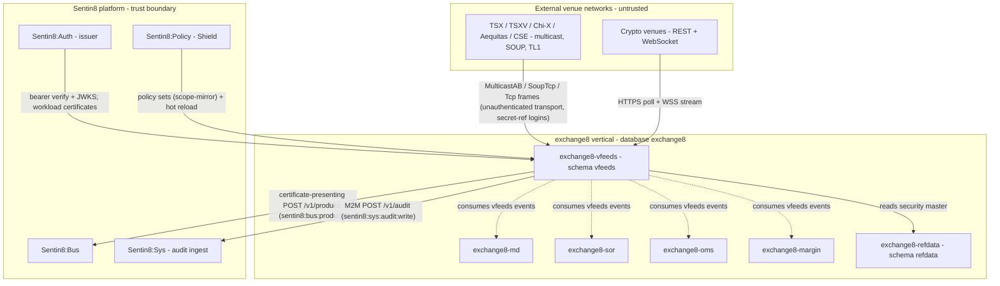

Container view:

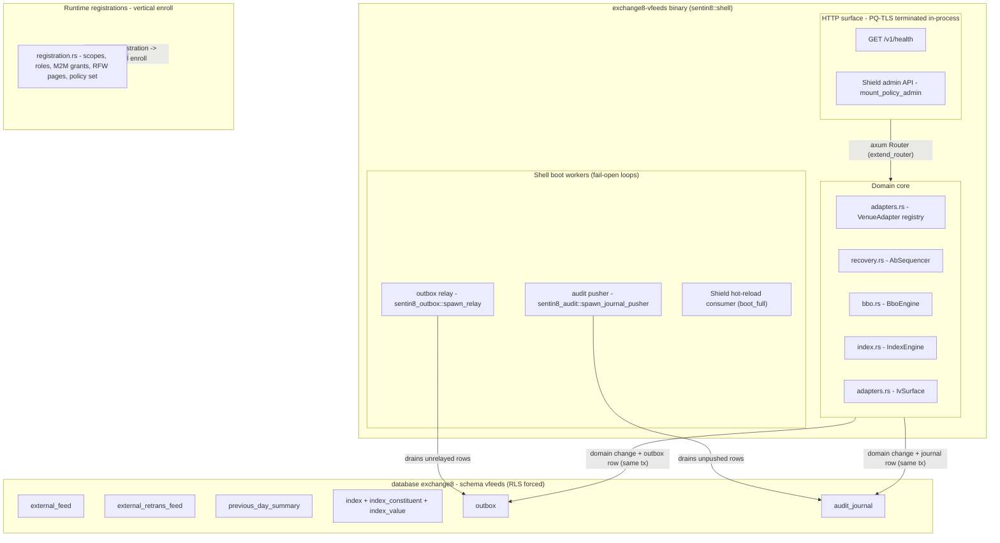

## 2. Runtime Architecture

Components inside the binary:

1. **Shell boot** (`sentin8::shell::serve`): `--print-registration` flag
   before any initialization → PQ provider install → env config
   (`EXCHANGE8_VFEEDS_PORT`, `EXCHANGE8_VFEEDS_DATABASE_URL`) → capped pool
   (`sentin8_config::pg_pool::connect`, default max 3) → PostgreSQL 18+
   enforcement → Shield engine boot (`boot_full`: policy-set load against the
   live platform table; unparsable text **refuses to start**) → state build →
   router assembly → middleware stack → in-process PQ-TLS accept loop.
2. **Router extension** (`main.rs::extend_router`): the only route addition is
   `mount_policy_admin` - the Shield admin API (policy sets, relations,
   attributes, decisions, RFW POST aliases). The shell mounts `/v1/health`
   with the in-flight gauge for the drain signal. The service declares RFW
   pages `feeds` (`/v1/admin/ui/feeds`, data `/v1/admin/feeds`) and `indices`
   (`/v1/admin/ui/indices`, data `/v1/admin/indices`) through registration;
   their backing handlers are listed in §10.
3. **Domain core**: the four modules `adapters.rs`, `recovery.rs`, `bbo.rs`,
   `index.rs` are pure and unit-tested in-module; workers and sockets wrap
   them. `bbo.rs` uses `exchange8::fixed::Price` (raw scale-4 fixed point).
4. **Boot workers** (shell-owned, fail-open): the outbox relay (drains
   `vfeeds.outbox` on `pg_notify('vfeeds_outbox_changed')` + a 5 s safety
   poll, pushes to Sentin8:Bus), the audit-journal pusher (drains
   `vfeeds.audit_journal` to Sentin8:Sys `POST /v1/audit`), and the Shield
   hot-reload direct consumer.
5. **Feed sessions** (ownership contract, `adapters.rs` docs): dedicated
   per-feed tasks own transports, SOUP login/sequenced/heartbeat, multicast
   joins, reconnection and backoff; they feed the A/B sequencer and adapters
   (spawn site noted in §10). Panics never cross feeds - task isolation keeps
   other venues streaming.

### Request family - venue feed connect / consume

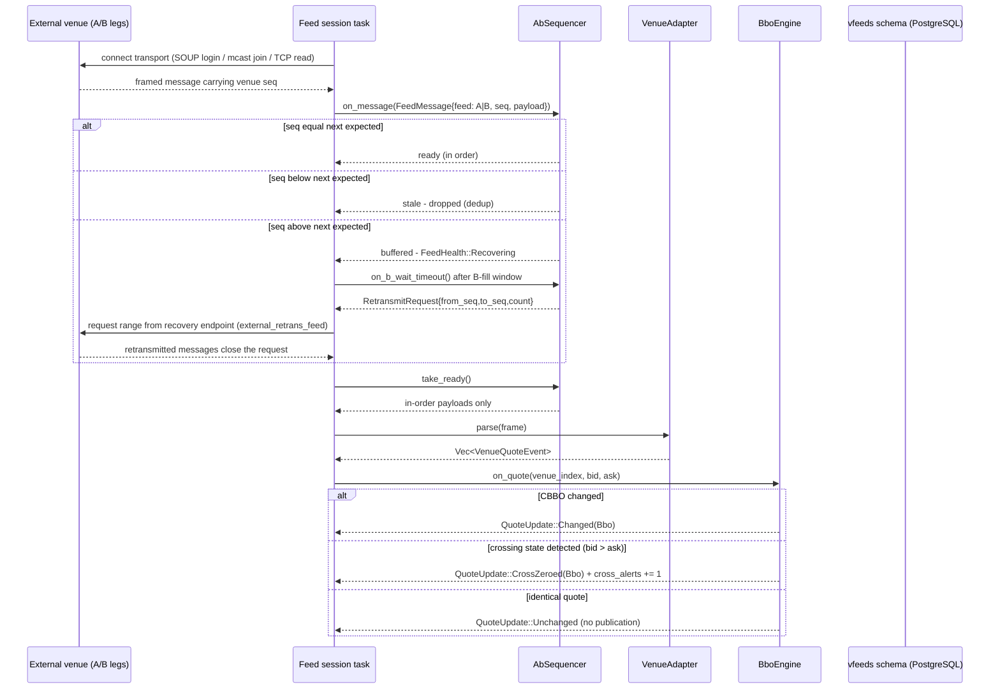

### Request family - tick / BBO fan-out to Exchange8:MD

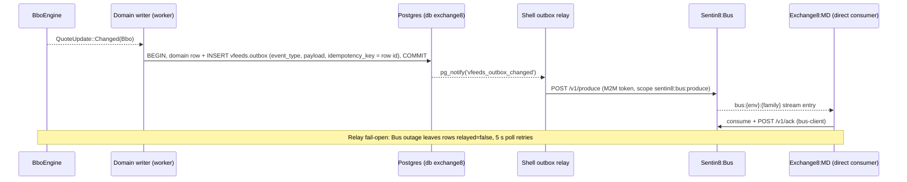

### Request family - index computation

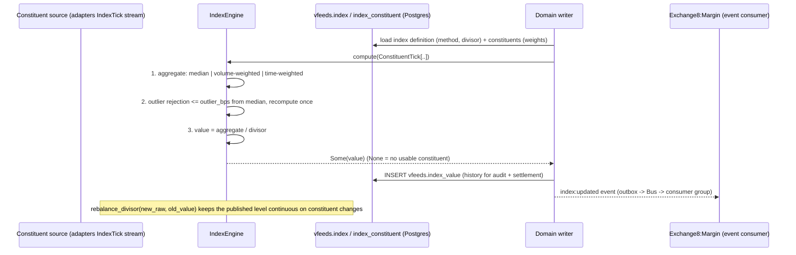

### Request family - recovery / replay

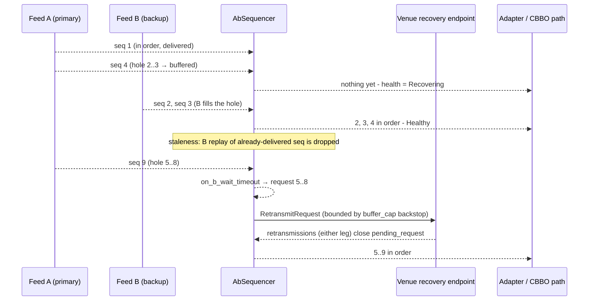

## 3. Data Model

Schema `vfeeds` in database `exchange8`; every table is tenant-scoped and
RLS-enforced. Role `exchange8_vfeeds_service` (no `BYPASSRLS`) gets DML grants
scoped to this schema; the service's DSN is `EXCHANGE8_VFEEDS_DATABASE_URL`
(user `exchange8_vfeeds_service`, OAuth token auth via `vertical-registry.json`).

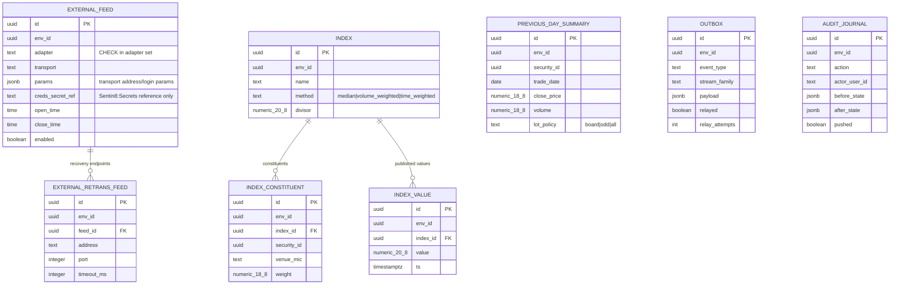

Per-table notes:

| Table | Ownership / visibility |
|---|---|
| `vfeeds.external_feed` | Tenant config. Adapter CHECK constraint is the compile-time registry (`stamp_cbbo`, `stamp_quotes`, `itch_orders`, `xmt`, `soup_tcp`, `mold_udp`, `fix`, `websocket`). `creds_secret_ref` is a Sentin8:Secrets reference - never plaintext. Select/insert/update/delete policies per operation. |
| `vfeeds.external_retrans_feed` | Per-feed retransmission endpoint (address, port, `timeout_ms` default 5000). FK to the owning feed. |
| `vfeeds.previous_day_summary` | One row per `(env_id, security_id, trade_date)`: close price, volume, lot policy (`board`/`odd`/`all`). Lot-policy source for gateway lot-size events. |
| `vfeeds.index` | Index definition: unique name per env; method CHECK (`median`, `volume_weighted`, `time_weighted` - the `IndexMethod` vocabulary the engine implements); divisor default 1.0. |
| `vfeeds.index_constituent` | Constituent rows `(index_id, security_id, venue_mic)` unique; `weight` default 1.0. Optional per-constituent venue for per-venue constituent indices. |
| `vfeeds.index_value` | Append-only published history; index `(env_id, index_id, ts)` for range reads. |
| `vfeeds.outbox` | Generated (`sentin8_outbox::outbox_table_sql("vfeeds")`). `relayed`/`relay_attempts` are relay state; partial index on unrelayed rows; `pg_notify` trigger `vfeeds.vfeeds_notify_outbox()` on insert. |
| `vfeeds.audit_journal` | Generated (`sentin8_audit::audit_journal_sql("vfeeds")`). Single `audit_journal_dml` policy; partial index on unpushed rows. |

RLS: every table carries `ENABLE` + `FORCE ROW LEVEL SECURITY` with policies
on the platform helpers `sentin8_context_initialized()` and
`sentin8_current_env_id()`; operations outside set context see zero rows
(silent enforcement, not an error).

## 4. API Surface

Audience groups and gates. Handler actions follow the scope-mirror policy set
(`registration.rs::SCOPE_MIRROR_POLICIES`); the registered error code is
`exchange8_feed_gap_detected` (HTTP 503, enum `Exchange8FeedGapDetected`).

**Operational / infrastructure**

| Endpoint | Gate | Purpose |
|---|---|---|
| `GET /v1/health` | none (shell) | Liveness + `build` + `active_connections` for captain drain |
| `GET /openapi.json` | none (middleware-free) | Shell-merged OpenAPI |

**Shield policy admin (mounted via `mount_policy_admin`; scope
`exchange8:vfeeds:policy:read` / `:write`; admin role `exchange8:vfeeds:admin`)**

| Endpoint | Gate | Purpose |
|---|---|---|
| `GET /v1/admin/policy-sets`, `GET /v1/admin/policy-sets/{name}` | policy read | List/get policy sets |
| `PUT /v1/admin/policy-sets/{name}`, `POST /v1/admin/policy-sets`, `POST /v1/admin/policy-sets/{name}/save` | policy write | Upsert/create/save sets |
| `DELETE /v1/admin/policy-sets/{name}` | policy write | Remove a set |
| `POST /v1/admin/policy-sets/{name}/test` | policy write | Dry-run authoring |
| `POST /v1/admin/policy-sets/enforce` / `shadow` / `disable` | policy write + RFW POST alias | Mode flips |
| `POST /v1/admin/policy-sets/{name}/{action}` | policy write + RFW POST alias | Row action |
| `GET /v1/admin/policy-decisions` | policy read | Decision history |
| `GET/PUT/DELETE /v1/admin/relations`, `GET /v1/admin/relations/check`, `GET/PUT/DELETE /v1/admin/attributes` | policy write | ReBAC graph admin |

**Admin / RFW (declared in registration; handlers in §10)**

| Page | UI / data endpoints | Gate |
|---|---|---|
| `feeds` | `/v1/admin/ui/feeds` + `/v1/admin/feeds` | `exchange8:feed:read` (mutating ops `exchange8:feed:write`) |
| `indices` | `/v1/admin/ui/indices` + `/v1/admin/indices` | `exchange8:index:read` (mutating ops `exchange8:index:write`) |
| Quote clear | `POST /v1/admin/quotes/clear` (side `bid`/`ask`/`both`) | `exchange8:feed:write` |

**Emitted events** (`exchange8:{service}:{resource}:{operation}`, outbox →
Bus; `idempotency_key` = outbox row id)

| Event | When |
|---|---|
| `exchange8:vfeeds:venue:quote` | Normalized venue quote event |
| `exchange8:vfeeds:bbo:updated` | CBBO change (source MICs carried) |
| `exchange8:vfeeds:feed:status` | Feed up/down/degraded, sequence gaps |
| `exchange8:vfeeds:index:updated` | Index recompute published |

Multi-party flow (external venue → vfeeds → Exchange8:MD):

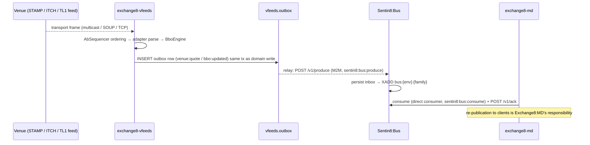

Event-flow (outbox → Bus → trigger):

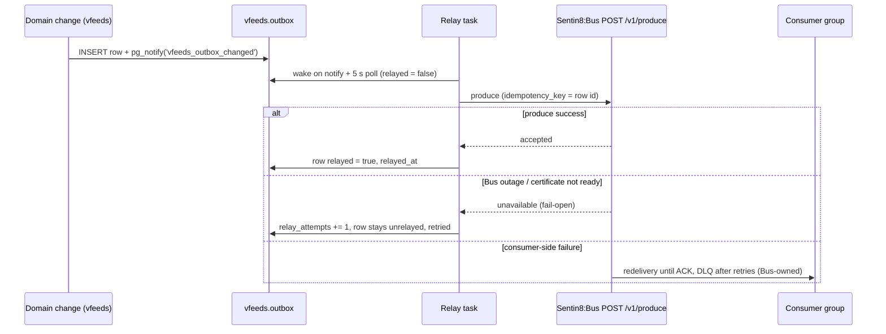

## 5. Cross-Cutting Concerns

**Authentication.** Sentin8:Auth is the only issuer. The shell middleware
stack (correlation, host context, TLS context, request logging, traffic
counter, CORS) front every route; inbound bearer tokens verify against the
Auth issuer (discovery + JWKS behind a shared client). Outbound clients
present the workload certificate (CERTFREE-4V - `ensure_workload_certificate`
behind `BusClient::for_workload`); a certificate-ensure failure
degrades only the fail-open relay/pusher paths, never the authorization path.

**Authorization (Shield).** The shell boots the engine (`boot_full`) from the
service's declared policy sets; unparsable text refuses to start. The seeded
`scope-mirror` set (`origin='platform'`, `mode='enforced'`) is the exact
mirror of handler gates over the LIVE effective scope: permits for
`exchange8:vfeeds:stream`, plus `sentin8:sys:admin` / `sentin8:sys:org:admin`
/ `sentin8:sys:env:admin` platform-admin permits. Step-5 decisions are
fail-closed (no set → deny; enforced no-match → deny; shadow never blocks;
forbid beats permit; M2M parity). Hot reload runs as a direct consumer of the
policy-change stream (`exchange8:vfeeds-policy` workload, `sentin8:bus:consume`).

**RLS context.** Tenant tables demand `SELECT sentin8_set_tenant_context($1)`
on the SAME connection/transaction as any data query (transaction-local
`set_config(..., true)`); the async helper must be awaited. Policies use
`sentin8_context_initialized()` + `sentin8_current_env_id()`, so unset context
sees and writes nothing.

**Idempotency & exactly-once.** Outbox rows carry `idempotency_key` (row id);
Bus dedupes on it. At-least-once Valkey delivery + idempotent consumers =
effectively-once. Stale retransmitted venue messages are dropped by the
sequencer, so replay never double-applies quote state.

**Rate limiting.** No route-level limiter in this binary; the venue rate
itself is naturally capped by transport (feed `enabled` flag, session health
events). Shield's decision history provides post-hoc analysis of admin-surface
call patterns.

**Audit journaling.** Auditable changes write `vfeeds.audit_journal` in the
same transaction as the domain change; the shell pusher (`vfeeds-audit`
workload, `sentin8:sys:audit:write`) drains to Sentin8:Sys `POST /v1/audit`.
A Sys outage delays, never drops, audit.

**Graceful drain.** `/v1/health` exposes `active_connections` from the
traffic counter; captain drains against the gauge during rolling upgrades.
Feed-session reconnection on upgrade is a new instance's session setup - no
durable feed state lives in the old process.

**TLS posture.** In-process PQ-TLS termination (`sentin8-tls`); the TLS
library is database-free - host context resolution rides Sys
`GET /v1/resolve/hostname` via the `exchange8-vfeeds-tls` workload (scope
`sentin8:sys:instances:read`) with a TTL cache, no DSN, no platform grants
. Never `danger_accept_invalid_certs`; credentials never ride the
wire in plaintext (secret references at rest, Sentin8:Secrets at fetch).

## 6. Failure Modes & Recovery

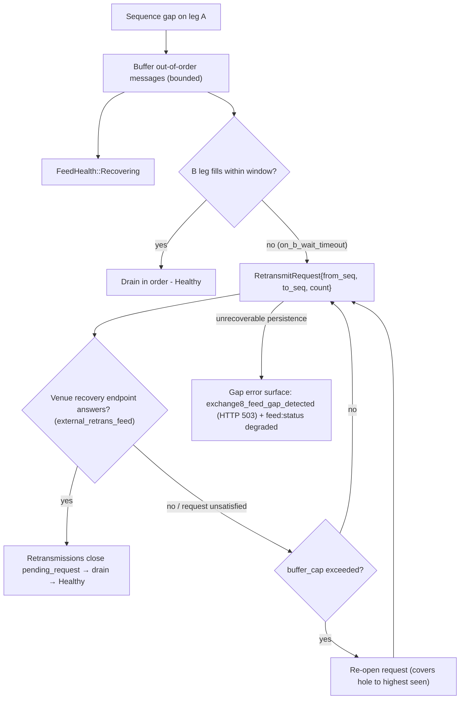

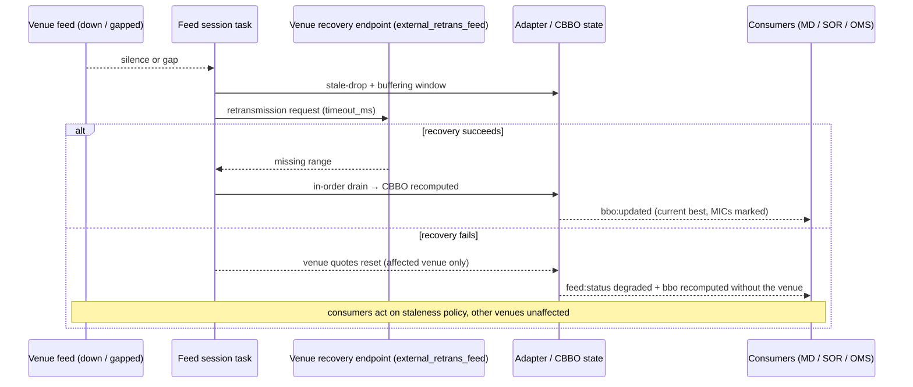

Other durable failures:

- **Relay→Bus outage**: rows stay `relayed = false`; relay re-opens with
  the workload certificate when Bus returns; the 5 s poll is the backstop.
  Nothing is lost in the service's database, and the service keeps serving.
- **Journal→Sys outage**: unpushed rows accumulate; pusher retries on its
  safety pass. Audit never drops.
- **PostgreSQL failure at boot**: pool connect or PG 18 check failure aborts
  startup (captain restarts the instance). Pool saturation is bounded by the
  capped pool (default 3).
- **Policy-set load failure at boot**: refuse-to-start (fail-closed). Shield
  hot reload failing at runtime keeps the last good engine loaded.
- **Adapter panic**: the per-feed task restarts with backoff; sibling feeds
  continue; a `feed:status` event marks the affected feed.
- **DLQ**: consumer-side trigger failures land in Sentin8:Bus's DLQ after
  retries for manual replay - never silently dropped.

## 7. Concurrency & Performance Model

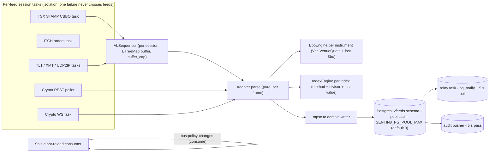

- **Task layout.** One dedicated task per feed config row (transport I/O,
  heartbeat, reconnect); workers for relay, audit pusher, Shield hot reload;
  the axum accept loop runs under `tls.serve`.
- **Locking.** Per-instrument engine state is owned by the consuming task -
  no shared mutex on the quote hot path; cross-task handoff is an mpsc
  hand-off to the single writer that performs transactional domain writes.
- **Hot paths.** CBBO recompute is a linear scan over a small dense venue
  array with early `Option` skips (design budget < 50 µs per update); adapter
  parse is branch-light, allocation-light for the binary adapters.
- **Backpressure.** Bounded buffer (`buffer_cap`) converts venue stall into
  retransmission demand instead of unbounded memory; the DB pool cap turns
  write pressure into queued outbox rows rather than pool exhaustion.
- **Metrics.** `active_connections` gauge via the shell traffic counter;
  cross-alert counter (`cross_alerts`) on the CBBO engine; per-feed health in
  `feed:status` events.

## 8. Invariants, Insecure-Defaults Rejected, Unsafe Rationale

**Invariants (always true)**

1. `AbSequencer` never delivers out of order: delivery requires
   `seq == next_seq`; buffer drain always preserves ascending sequence.
2. Stale (`seq < next_seq`) venue messages are dropped - replay from either
   leg never re-applies delivered state.
3. `BboEngine` consolidated sides consider only non-empty venue quotes; a
   venue with no quote can never win a best scan.
4. A crossed consolidated state triggers zeroing of the crossing venue's
   quote, an alert increment, and never publishes the crossed pair.
5. Index publication is `None` when the divisor is non-positive or no usable
   constituent remains; the divisor only changes via `rebalance_divisor`,
   which keeps the published level continuous.
6. Domain change and its `vfeeds.outbox` / `vfeeds.audit_journal` row commit
   in the same transaction.
7. Every RLS-protected table is `ENABLE` + `FORCE`d; the service role is
   granted only on schema `vfeeds` (plus the declared `SELECT` on
   `refdata.security`).
8. `creds_secret_ref` never contains plaintext credentials; adapters receive
   resolved or referenced credentials only at session setup.
9. Shield is fail-closed: no loaded set denies; enforced no-match denies;
   shadow never blocks; forbid dominates permit; `token_tp` never bypasses.

**Insecure defaults rejected**

- Dense zero-filled venue arrays with best-scan zero-inclusion (an empty venue
  could win the "best ask" scan) - replaced by `Option`-based storage.
- Plaintext credential columns on feed rows - secret references only.
- `BYPASSRLS` on any service role - rejected platform-wide.
- Emitting quotes as raw venue payloads to consumers - only the normalized
  event model crosses the boundary.
- Startup with unparsable policy sets - refuse-to-start instead of
  running unguarded.

**Unsafe rationale.** The crate contains no `unsafe` blocks. PQ-TLS and
crypto provider setup are owned by the platform shell (`sentin8-tls`), not by
this service.

## 9. Testing Strategy

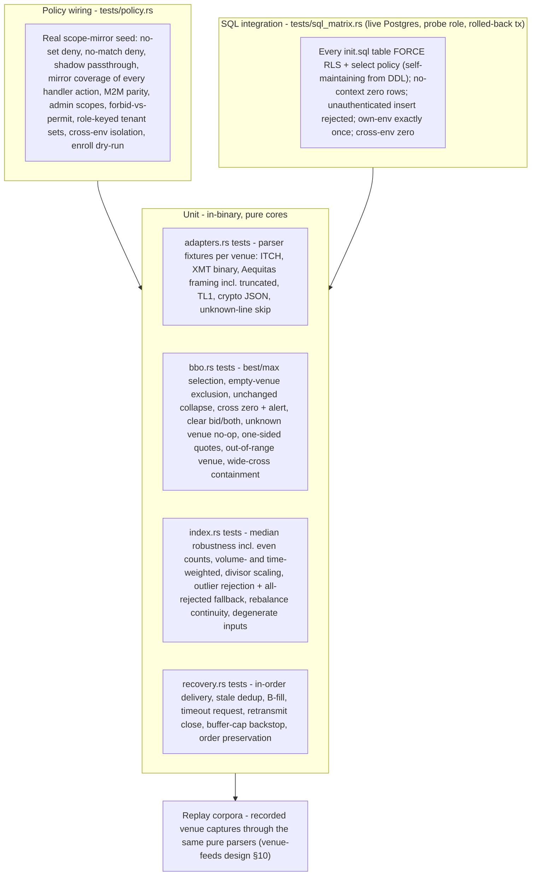

- **Unit/pure**: every adapter parser, CBBO rules, index math, A/B recovery -
  deterministic, offline (`cargo test` needs no DB; integration tests skip
  silently offline).
- **Policy wiring**: `tests/policy.rs` loads the *real* seeded policy text via
  `registration::SCOPE_MIRROR_POLICIES` and proves the fail-closed/delegated
  semantics with hand-built rows (no DB).
- **RLS matrix**: `tests/sql_matrix.rs` connects as the `exchange8_probe`
  non-bypass role and derives its assertions from this service's own
  `init.sql`; all fixture work rides one rolled-back transaction.
- **Not tested here** (platform level): token issuance/verification, Bus
  broker internals, captain drain mechanics, cross-service E2E flows - covered
  by the platform's testing strategy and sibling services.

## 10. Open Questions

- **Feed-session spawn site**: the per-feed transport task (SOUP login,
  heartbeat, multicast join, REST/WebSocket loops) and its reconnect-backoff
  policy are the adapter framework's ownership contract in `adapters.rs`, but
  the spawn site (state build vs. router extension) is not yet wired in
  `main.rs`; the in-binary modules ship as pure cores today.
- **Event emission sites**: the declared event families (`venue:quote`,
  `bbo:updated`, `feed:status`, `index:updated`) need their outbox write sites
  on the engine and writer paths; no `event_triggers` are declared in
  registration yet.
- **Admin data endpoints**: `Feeds` and `Indices` RFW pages are registered,
  and the design names quote-clear and feed enable/disable; the backing
  handlers (including the `bid|ask|both` clear surface) are the remaining
  wiring.
- **Index-method vocabulary drift**: the `vfeeds.index.method` CHECK and the
  `IndexMethod` engine enum must stay the same vocabulary (`median`,
  `volume_weighted`, `time_weighted`) - a schema CHECK naming methods the engine
  does not implement would strand any row configured with them. The alignment is
  maintained by the engine's own serialization tests.
- **Index publication cadence**: tick-driven vs periodic index snapshots, and
  where `previous_day_summary` lot-policy events to gateways sit on that path
  (design-only facts not observable in this unit's sources).
- **Venue matrix completeness**: `vfeeds.external_feed.adapter` CHECK accepts
  the adapter names above, while the venue-feeds design also lists
  `alpha_l1` and Aequitas order/depth book types (LIT/NEO/DARK) on the
  adapter registry; reconciliation of the compile-time set with the CHECK list
  is outstanding.
- **Metrics surface**: cross alerts are counted in-process; the metric
  emission shape (`vfeeds_bbo_cross_alerts_total`, per-feed msg/s, gap counts,
  CBBO latency) lives with the platform stat emitter's semantics.

---

**Architecture & Design:** exchange8:vfeeds and its underlying concepts were designed by [Hamid Jahanzad](https://www.linkedin.com/in/hamidjahanzad/).
