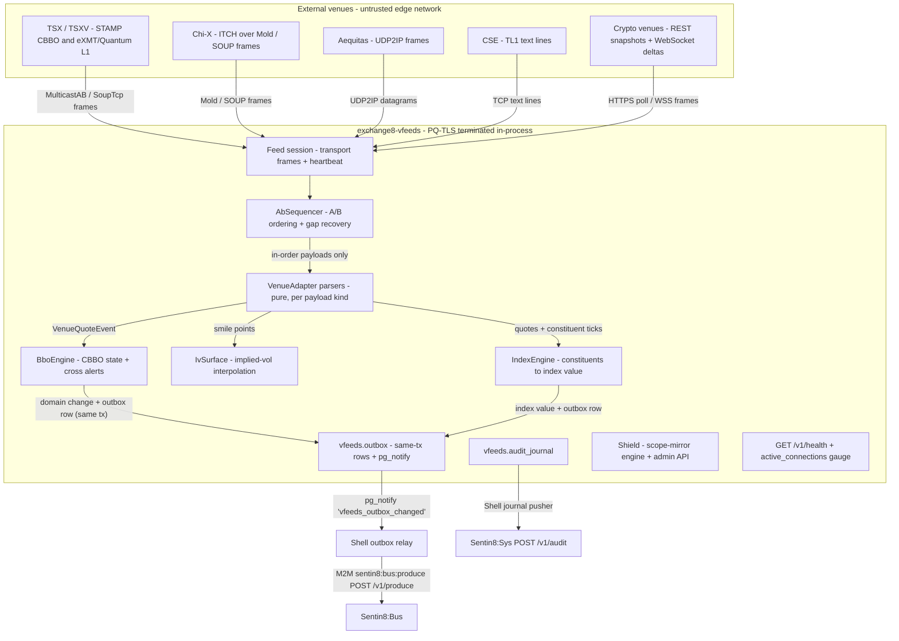

# Exchange8:VFeeds - External Venue Feeds, Consolidated BBO, Index Engine

> Overview - what Exchange8:VFeeds is, why it exists, and how it fits the exchange8
> platform. Wire-level detail lives in `DESIGN.md`; business functionality in
> `BUSINESS.md`.

## 1. Summary

Exchange8:VFeeds is the exchange8 **external venue edge**. It connects to upstream
trading venues and market-data providers, normalizes every vendor transport
and payload into a single internal quote-event model, recovers message loss with
dual-feed (A/B) sequence handling, and maintains the per-instrument **consolidated
best bid/offer (CBBO)** across all configured venues. The same service owns the
**index engine** - constituent weighting, outlier rejection, and divisor
continuity across rebalancing - whose values price margins and fund perpetuals,
plus the previous-day close summary and lot policy the gateways need. It is the
exclusive source of external market state inside the vertical: no other
exchange8 service holds a venue connection.

## 2. Motivation

- **One quote model, N vendors.** Every venue speaks a different transport and
  payload (multicast stamps, binary packets, SOUP/ITCH frames, TL1 text, REST
  snapshots, WebSocket deltas). Downstream consumers - smart order routing,
  order management, market-data publication - need one normalized event, not N
  parsers of their own.
- **A crossed consolidated book is an incident, not a quirk.** CBBO is
  high-frequency, correctness-critical state. Empty venues must never win a
  "best" scan, and a bid above ask across venues must be contained (zeroed +
  alerted) rather than propagated.
- **Venue feeds fail independently.** Packet gaps, reboots, and provider
  outages are routine. The market picture must recover *in order* (buffer →
  backup leg → retransmission) instead of silently resynchronizing.
- **Margin and funding need a reference price, not a venue.** Exchanges settle
  and fund against a robust index value computed from constituents, with
  outlier protection and continuity across constituent changes.
- **Feed configuration is tenant data.** Which venues, which transports, which
  credentials, whether a feed is enabled - these are env-scoped rows with the
  same RLS isolation as every other exchange8 table; credentials are stored as
  secret references, never plaintext.

## 3. Architecture & High-Level Design

The service is a Rust axum binary mounted on the shared Sentin8 Shell
(`sentin8::shell`): the shell owns boot order, the DB pool, `/v1/health`, the
Shield (Sentin8:Policy) admin API, middleware, and PQ-TLS termination.
Exchange8:VFeeds contributes one pure core and a thin shell extension:

- **Adapter framework** (`adapters.rs`): a compile-time registry of pure
  parsers - bytes in, `VenueQuoteEvent` out. Transports span dual-leg
  multicast, SoupBinTCP, plain TCP (TL1), UDP2IP datagrams, crypto REST
  and WebSocket frames.
- **A/B sequencer** (`recovery.rs`): per-session ordering on the dual legs -
  in-order delivery, stale-drop dedup, bounded gap buffering, B-fill wait,
  then retransmission requests to the venue recovery endpoint.
- **CBBO engine** (`bbo.rs`): per-instrument consolidated top of book with
  strict non-empty quote selection, cross detection (zero + alert), and the
  stale-quote clear administrative operation.
- **Index engine** (`index.rs`): median / volume-weighted / time-weighted
  aggregates with outlier rejection and divisor-continuity rebalancing.
- **Persistence**: domain rows plus a `vfeeds.outbox` row in the same
  transaction; the shell relay pushes to Sentin8:Bus; an audit-journal pusher
  mirrors every auditable change to Sentin8:Sys.

Consumers of the normalized events and the CBBO/index outputs are the
downstream exchange8 services: Exchange8:MD (re-publication), Exchange8:SOR (per-venue
quotes), Exchange8:OMS (external best bid/offer), Exchange8:Margin (mark-to-market and
funding) and Exchange8:Settlement (index value history).

## 4. Key Traits and Data Structures

Concepts as implemented; signatures live in the source and `DESIGN.md`.

- **`VenueAdapter` contract** - the pluggable parser boundary: an adapter
  exposes a registry name, the payload kinds it produces, its configured
  transport, and a frame parser that turns bytes into normalized events.
  Adapters are pure and stateless; sockets, heartbeats, and supervision are the
  session task's job. New venue support is a new adapter implementation plus a
  `vfeeds.external_feed` row - no downstream changes.
- **`Transport` vocabulary** - the enum of connectable transports: dual-leg
  multicast (A/B), single multicast, SoupBinTCP, plain TCP, UDP2IP, crypto
  REST poller, crypto WebSocket.
- **`VenueQuoteEvent`** - the single normalized quote model: instrument,
  four-byte venue MIC, venue timestamp and receive timestamp (dual clocks),
  quote kind (best / depth / order book / status), optional bid, ask, depth
  levels, lot size, and venue sequence. Consumers build whatever they need on
  top of it.
- **`BboEngine`** - per-instrument CBBO state machine. Venue quotes are stored
  as `Option`s (`None` = no quote), the consolidated best scans strictly
  non-empty sides, changes collapse to an `Unchanged/Changed/CrossZeroed`
  outcome, and the cross path zeroes both sides and bumps the cross-alert
  counter. `ClearSide` (bid / ask / both) is the stale-quote clear vocabulary
  of the admin surface.
- **`IndexEngine`** - method (median, volume-weighted, time-weighted), an
  outlier tolerance in basis points from the median, a divisor, and the
  rebalance rule that keeps the published value continuous when the
  constituent set changes.
- **`IvSurface` / `IvPoint`** - per-instrument implied-volatility points
  (strike, expiry, IV in bps) with nearest-expiry banding and linear strike
  interpolation; the pricing input for Greeks.
- **`AbSequencer`** - the A/B recovery core: monotonic next-expected sequence,
  ordered buffer (`BTreeMap`), stale-drop dedup, bounded buffer with forced
  retransmission, and explicit retransmission request windows.
- **Persistence shapes** - `vfeeds.external_feed` (+ `params` JSONB and the
  secret reference column), `vfeeds.external_retrans_feed` (per-feed recovery
  endpoints), `vfeeds.previous_day_summary` (close price, volume, lot
  policy), `vfeeds.index` / `vfeeds.index_constituent` / `vfeeds.index_value`,
  and the generated `vfeeds.outbox` / `vfeeds.audit_journal`.

## 5. Rationale, Trade-offs, and Alternatives

- **Pure parser cores with owned sockets elsewhere.** Adapters are deterministic
  byte → event functions; the seam keeps parsing replayable (recorded venue
  captures run through the same code in tests) and keeps reconnect/heartbeat
  policy in one place. A monolithic adapter owning its sockets would be
  untestable offline; a fully generic trait-object framework was rejected
  because the adapter set is compile-time known and every adapter is
  dispatch-once.
- **Raw fixed-point integers for market data, `f64` for index math.** Quote
  prices and CBBO comparisons use raw integer ticks (deterministic, exact).
  Index computation is statistics (medians, weighted averages, interpolation),
  so it computes in `f64` with a documented rounding boundary; mixing the two
  scales would force lossy conversions on the hot path.
- **`Option`-based empty quotes instead of a dense zero-filled array.** The
  array form allowed empty (zero-price) venues to win best-scan comparisons;
  the current design excludes empties structurally, which is also why the cross
  detector can require both sides to be present.
- **Bounded buffer + explicit retransmit windows.** Unbounded buffering turns a
  venue outage into memory exhaustion; immediate retransmit storms the recovery
  endpoint. The A/B design waits an observation window for the B leg, then
  requests exactly the missing sequence range.
- **Same-transaction outbox.** Domain change and `vfeeds.outbox` row commit
  together; the relay is fail-open (rows persist and retry) while the policy
  engine boots fail-closed (unparsable policy text refuses to start). Both are
  deliberate: durability of market events may queue, but authorization may
  never run unsourced.
- **Mimalloc globally.** The binary is allocation-heavy at market-data rates;
  the platform-standard allocator choice is made once at the binary level and
  covers every in-process task.

## 6. Internal Implementation & Invariants (Private Design)

- **In-order delivery is unconditional.** The sequencer never emits a gap. A
  message below `next_seq` is stale (dropped), above `next_seq` is buffered,
  on the nose is delivered and drains the ordered buffer.
- **CBBO selection excludes empty venues structurally**, and a crossed
  consolidated state (best bid > best ask) is zeroed on the crossing update,
  counted in the cross-alert metric, and never published as-is.
- **`compute_index` (adapters) vs `IndexEngine` (index.rs)** are two scales of
  the same idea: the former is the tick-level helper over venue events with
  share-count weights; the latter is the persisted-index engine over
  `vfeeds.index_constituent` weights with outlier rejection and divisor
  continuity.
- **RLS context is transaction-local** and must be set on the same connection
  as the data query; the async `set_tenant_context` helper must be awaited or
  the context silently never lands.
- **Secrets are references.** `vfeeds.external_feed.creds_secret_ref` carries a
  Sentin8:Secrets reference; no adapter ever sees a plaintext credential.
- **Service role is scope-minimal.** The single PostgreSQL role is
  `exchange8_vfeeds_service` (no `BYPASSRLS`), granted only on schema `vfeeds`
  plus the declared read-only cross-schema grant `SELECT` on
  `refdata.security`.
- **The relay and journal pusher are fail-open loops** - a Sentin8:Bus or
  Sentin8:Sys outage delays delivery but never drops rows; both workers poll on
  a short safety timer in addition to their notify/push triggers.

## 7. Unresolved Questions / Future Designs

- Session-supervisor wiring: the per-feed transport tasks (SOUP login,
  multicast join, REST/WebSocket loops) and their reconnect backoff are
  specified by the adapter framework's ownership rule; the spawn site is the
  remaining piece (see `DESIGN.md` §10).
- Emission of the declared event families (`exchange8:vfeeds:venue:quote`,
  `exchange8:vfeeds:bbo:updated`, `exchange8:vfeeds:feed:status`,
  `exchange8:vfeeds:index:updated`) into `vfeeds.outbox` from the engine
  hot paths.
- Admin data endpoints backing the registered RFW pages (`Feeds`,
  `Indices`) and the quote-clear / feed-enable operations.
- Publication cadence and staleness policy for CBBO and index values
  (tick-driven vs periodic snapshots).

---

**Architecture & Design:** exchange8:vfeeds and its underlying concepts were designed by [Hamid Jahanzad](https://www.linkedin.com/in/hamidjahanzad/).
